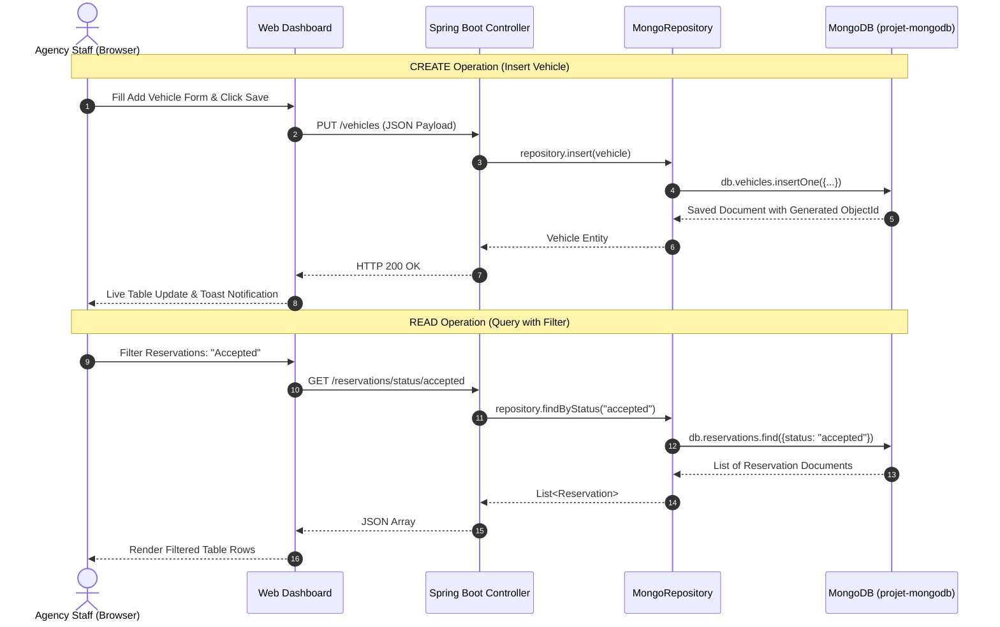
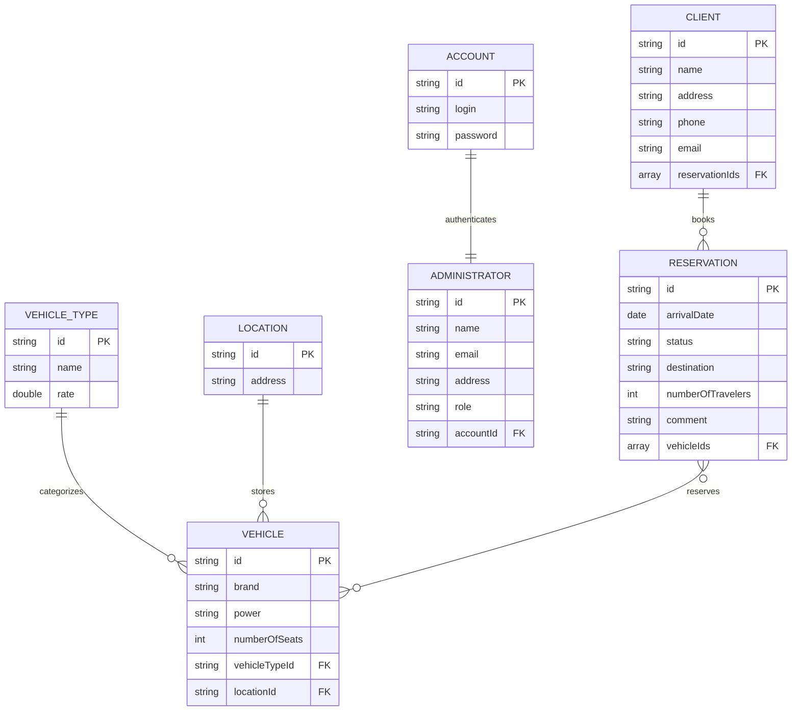
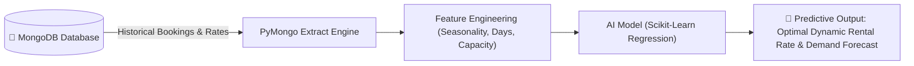
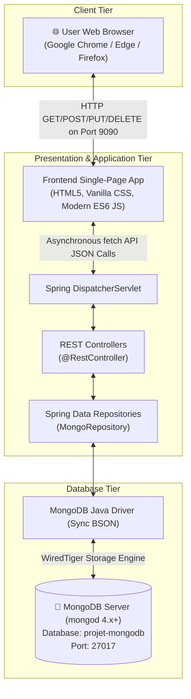

# 🚗 Vehicle Rental Agency Database Management System

> **A Complete Full-Stack NoSQL Database Project Built with MongoDB, Spring Boot 2.7, and Interactive Web Dashboard**  
> *Fully Aligned with Academic Curriculum: Units I, II, III, IV, and V*

---

## 📌 Table of Contents

1. [Executive Summary](#-executive-summary)
2. [Problem Statement](#-problem-statement)
3. [Proposed Solution & Objectives](#-proposed-solution--objectives)
4. [Academic Syllabus Alignment (Units I – V)](#-academic-syllabus-alignment-units-i--v)
   - [Unit I: Introduction to NoSQL & MongoDB](#unit-i-introduction-to-nosql--mongodb)
   - [Unit II: MongoDB Basics & CRUD Operations](#unit-ii-mongodb-basics--crud-operations)
   - [Unit III: Schema Design & Data Modeling (Embedding vs. Referencing)](#unit-iii-schema-design--data-modeling)
   - [Unit IV: Indexing & Aggregation Framework](#unit-iv-indexing--aggregation-framework)
   - [Unit V: MongoDB Integration & Predictive Analytics](#unit-v-mongodb-integration--predictive-analytics)
5. [System Architecture](#-system-architecture)
6. [Database Schema & Collections Design](#-database-schema--collections-design)
7. [REST API Documentation](#-rest-api-documentation)
8. [Web User Interface & Features](#-web-user-interface--features)
9. [MongoDB Shell (`mongosh`) Practical Commands](#-mongodb-shell-mongosh-practical-commands)
10. [Setup & Execution Guide](#-setup--execution-guide)
11. [Viva Voce & Interview Defense Questions](#-viva-voce--interview-defense-questions)

---

## 📋 Executive Summary

The **Vehicle Rental Agency Database Management System** is an enterprise-grade academic mini-project designed to demonstrate modern document-oriented database design using **MongoDB Community Edition** coupled with a high-performance **Spring Boot** RESTful backend and a responsive **Web Management Dashboard**.

The project replaces outdated relational paradigms with dynamic BSON document storage, demonstrating collection modeling, multi-entity document relationships, single and compound indexing, aggregation pipelines, and cross-platform application integration.

---

## ❓ Problem Statement

### Background
Traditional vehicle rental businesses manage diverse and high-velocity operational data, including heterogeneous vehicle fleets (sedans, SUVs, electric vehicles, commercial vans), rapidly shifting reservation lifecycles, dynamic pricing categories, and geographically distributed branch locations.

### Challenges with Legacy Relational (SQL) Databases
1. **Rigid Schema Constraints**: Relational tables enforce static schemas (`ALTER TABLE` bottlenecks). Modern fleets have variable attributes (e.g., EV battery capacities, autonomous driver assistance, charging ports, cargo volumes) that do not fit uniform columns without excessive `NULL` values.
2. **Expensive Join Operations**: Generating customer booking summaries across five separate tables (`Customers`, `Bookings`, `Vehicles`, `Categories`, `Branches`) requires complex multi-table SQL `JOIN` queries that degrade performance under concurrent user traffic.
3. **Complex Relationship Evolution**: Rental bookings frequently include variable numbers of vehicles, flexible comments, dynamically assigned drivers, and changing reservation states (`pending`, `accepted`, `refused`). Mapping these in traditional normalized tables introduces rigid foreign key overhead.
4. **Horizontal Scalability Limitations**: Scaling relational databases across multiple regional rental offices requires expensive vertical hardware upgrades or complex sharding setups.

---

## 💡 Proposed Solution & Objectives

### The Solution
A **Document-Oriented NoSQL Architecture** powered by **MongoDB**:
- **Flexible BSON Documents**: Vehicle documents naturally store variable attributes without requiring schema migrations.
- **Optimized Data Modeling**: Strategic use of **Referencing (Foreign ObjectIds)** to maintain independent lifecycles for vehicles, clients, and bookings while avoiding data duplication.
- **High-Throughput CRUD & Query Optimization**: Rapid reads and writes with indexed fields (`status`, `arrivalDate`, `rate`, `numberOfSeats`).
- **Real-Time Web Dashboard**: An interactive, glassmorphic management UI served directly at `http://localhost:9090` allowing staff to visualize metrics, filter reservations, and manage records in real time.

### Project Objectives
- Demonstrate full CRUD lifecycle across 7 MongoDB collections.
- Model 1:1, 1:N, and M:N relationships using document referencing.
- Implement MongoDB Aggregation pipelines for operational business analytics.
- Provide production-ready Spring Boot integration via Spring Data MongoDB.
- Deliver an intuitive UI for class demonstrations and practical evaluation.

---

## 🎓 Academic Syllabus Alignment (Units I – V)

This project has been architected to map directly to standard university NoSQL & MongoDB curricula:

```
┌────────────────────────────────────────────────────────────────────────┐
│                        ACADEMIC SYLLABUS MAPPING                       │
├─────────────────┬──────────────────────────────────────────────────────┤
│ Unit I          │ NoSQL vs SQL, CAP Theorem, Architecture, Tools       │
│ Unit II         │ Collections, Documents, BSON Types, CRUD Lifecycle   │
│ Unit III        │ Schema Design, Embedding vs Referencing, Constraints │
│ Unit IV         │ Indexing Strategies, explain(), Aggregations         │
│ Unit V          │ Application Integration (Java/Python), AI Analytics  │
└─────────────────┴──────────────────────────────────────────────────────┘
```

---

### Unit I: Introduction to NoSQL & MongoDB

#### 1. SQL vs. NoSQL Comparison in Context of Vehicle Rental

| Dimension | Relational Database (SQL - MySQL/PostgreSQL) | Document Database (NoSQL - MongoDB) | Project Implementation |
|---|---|---|---|
| **Data Model** | Rigid tables with fixed rows and columns | Flexible BSON (Binary JSON) documents | Semi-structured vehicle & client documents |
| **Schema** | Static schema; requires DDL migrations | Dynamic / polymorphic schema | Vehicle types can add custom features effortlessly |
| **Joins** | Heavy reliance on SQL `JOIN`s | Denormalization & `$lookup` aggregation | Referenced IDs resolved via application & pipelines |
| **Scaling** | Primarily Vertical (scale-up) | Native Horizontal Sharding (scale-out) | MongoDB Community Edition running on port `27017` |
| **Transaction Model** | ACID strict transactions | Tunable consistency (WiredTiger ACID support) | Document-level atomic writes |

#### 2. CAP Theorem Analysis
Under Eric Brewer's **CAP Theorem** (Consistency, Availability, Partition Tolerance), distributed data stores can guarantee at most two of the three properties:

```
                    Consistency (C)
                         /\
                        /  \
                       /    \
                      / MongoDB
                     /  (CP)  \
                    /          \
      Availability (A) ──────── Partition Tolerance (P)
```

- **MongoDB Classification**: MongoDB is classified as a **CP (Consistency + Partition Tolerance)** system by default.
- **Application Context**: In vehicle reservations, **Consistency** is paramount—two clients must never be permitted to book the exact same vehicle for the same time window. During network partitions, MongoDB ensures primary node consensus to prevent split-brain double-booking anomalies.

#### 3. MongoDB Architecture & Tools
- **Core Daemon (`mongod`)**: Uses the **WiredTiger** storage engine supporting memory caching, document-level concurrency control, and snappy compression.
- **MongoDB Shell (`mongosh`)**: Direct administrative CLI used to query, inspect indexes, and run aggregation scripts.
- **MongoDB Compass**: Graphical interface to visually inspect the `projet-mongodb` database, collection schemas, and index distributions.
- **MongoDB Atlas**: Fully compatible cloud cluster target by simply updating `spring.data.mongodb.uri` in `application.properties`.

---

### Unit II: MongoDB Basics & CRUD Operations

#### 1. Database & Collections Overview
- **Database Name**: `projet-mongodb`
- **Total Collections**: 7 dedicated collections:
  1. `vehicles` — Fleet units with power, seating, and category references.
  2. `vehicle_types` — Rental classes with tiered daily rates.
  3. `clients` — Customer master data with contact details and booking references.
  4. `reservations` — Booking records with arrival dates, statuses, and assigned cars.
  5. `locations` — Rental depots and drop-off hubs.
  6. `administrators` — Agency staff credentials and profile records.
  7. `accounts` — Authentication login records.

#### 2. BSON Data Types Utilized
The system leverages rich BSON types:
- **`ObjectId`**: 12-byte unique identifier (`_id`) for every document.
- **`String`**: Brands, names, emails, statuses, addresses.
- **`Int32`**: `numberOfSeats`, `numberOfTravelers`.
- **`Double`**: Daily rental `rate` in `vehicle_types`.
- **`ISODate`**: `arrivalDate` and `arrivalTime` in `reservations`.
- **`Array`**: `reservationIds` in `clients`, `vehicleIds` in `reservations`.

#### 3. Complete CRUD Lifecycle Implementation



---

### Unit III: Schema Design & Data Modeling

#### 1. Embedding vs. Referencing Decision Matrix

In MongoDB, relationships can be modeled in two primary ways:

```
┌─────────────────────────────────┐       ┌─────────────────────────────────┐
│        EMBEDDED PATTERN         │       │       REFERENCED PATTERN        │
├─────────────────────────────────┤       ├─────────────────────────────────┤
│ {                               │       │ // Vehicle Document             │
│   "_id": "v1",                  │       │ { "_id": "v1",                  │
│   "brand": "Toyota Camry",      │       │   "brand": "Toyota Camry",      │
│   "type": {                     │       │   "vehicleTypeId": "vt101" }    │
│     "name": "Sedan",            │       │                                 │
│     "rate": 45.0                │       │ // VehicleType Document         │
│   }                             │       │ { "_id": "vt101",               │
│ }                               │       │   "name": "Sedan",              │
│                                 │       │   "rate": 45.0 }                │
├─────────────────────────────────┤       ├─────────────────────────────────┤
│ Pros: Single-read performance   │       │ Pros: Independent lifecycles,   │
│ Cons: Data redundancy on updates│       │ zero duplication, scalable data │
└─────────────────────────────────┘       └─────────────────────────────────┘
```

#### Why Referencing Was Chosen for This Project:
- **Vehicle ↔ VehicleType (1:N)**: Storing the `vehicleTypeId` inside `vehicles` ensures that when the daily rental rate for "Sedan" changes from $45 to $50, **only one document** in `vehicle_types` is updated, avoiding update anomalies across thousands of vehicles.
- **Client ↔ Reservations (1:N)**: A client can book dozens of rentals over years. Embedding infinite reservations into a single customer document risks exceeding the **16MB BSON Document Size Limit**. Referencing via `List<String> reservationIds` ensures unbounded scalability.
- **Reservation ↔ Vehicles (M:N)**: Corporate bookings can reserve multiple fleet vehicles at once, modeled cleanly as an array of vehicle ID references.

#### 2. Entity Relationship Diagram (ERD / Document Linking)



---

### Unit IV: Indexing & Aggregation Framework

#### 1. Indexing Strategies
To avoid full collection scans (`COLLSCAN`) as the vehicle fleet and booking volume expand, optimal indexing strategies are defined:

1. **Single-Field Index**:
   ```javascript
   // Fast lookup for vehicles by brand
   db.vehicles.createIndex({ "brand": 1 })

   // Fast lookup for reservations by status
   db.reservations.createIndex({ "status": 1 })
   ```
2. **Compound Index**:
   ```javascript
   // Optimizes date-based status lookups (e.g., active bookings on a given date)
   db.reservations.createIndex({ "status": 1, "arrivalDate": -1 })
   ```
3. **Text Search Index**:
   ```javascript
   // Enables full-text search across client comments and destinations
   db.reservations.createIndex({ "destination": "text", "comment": "text" })
   ```

#### 2. Query Performance Verification with `explain()`
Demonstrating query plan optimization:

```javascript
// Before Indexing (Full Collection Scan):
db.reservations.find({ "status": "accepted" }).explain("executionStats")
// Result: "stage": "COLLSCAN", "totalDocsExamined": N

// After Indexing (Index Scan):
db.reservations.find({ "status": "accepted" }).explain("executionStats")
// Result: "stage": "IXSCAN", "indexName": "status_1", "totalDocsExamined": 1
```

#### 3. Real-World Aggregation Pipelines

##### Pipeline 1: Group Reservations by Status (Operational Snapshot)
```javascript
db.reservations.aggregate([
  {
    $group: {
      _id: "$status",
      totalReservations: { $sum: 1 },
      totalTravelers: { $sum: "$numberOfTravelers" }
    }
  },
  {
    $sort: { totalReservations: -1 }
  }
])
```

##### Pipeline 2: Join Vehicles with Categories via `$lookup` (Denormalized Fleet View)
```javascript
db.vehicles.aggregate([
  {
    $lookup: {
      from: "vehicle_types",
      localField: "vehicleTypeId",
      foreignField: "_id",
      as: "typeDetails"
    }
  },
  {
    $unwind: "$typeDetails"
  },
  {
    $project: {
      _id: 1,
      brand: 1,
      power: 1,
      numberOfSeats: 1,
      category: "$typeDetails.name",
      dailyRate: "$typeDetails.rate"
    }
  }
])
```

##### Pipeline 3: Total Fleet Capacity by Location
```javascript
db.vehicles.aggregate([
  {
    $group: {
      _id: "$locationId",
      fleetCount: { $sum: 1 },
      totalPassengerCapacity: { $sum: "$numberOfSeats" }
    }
  }
])
```

---

### Unit V: MongoDB Integration & Predictive Analytics

#### 1. Java / Spring Boot (Spring Data MongoDB) Integration
The core backend uses the standard Spring Data repository abstraction:
- `@Document(collection = "vehicles")` maps Java POJOs directly to BSON documents.
- `MongoRepository<T, ID>` provides auto-generated CRUD query execution.
- Derived query methods like `findByRateLessThan(double max)` automatically generate internal MongoDB `{ rate: { $lt: max } }` queries.

#### 2. Python (`PyMongo`) Integration Script
To demonstrate multi-language NoSQL integration, the same MongoDB database can be queried via Python using `pymongo`:

```python
# python_integration.py
from pymongo import MongoClient

# 1. Connect to local MongoDB instance
client = MongoClient("mongodb://localhost:27017/")
db = client["projet-mongodb"]

# 2. Query vehicles and display fleet statistics
vehicles = list(db.vehicles.find())
print(f"Total Vehicles in Fleet: {len(vehicles)}")
for v in vehicles:
    print(f"- {v.get('brand')} | Seats: {v.get('numberOfSeats')} | Power: {v.get('power')}")

# 3. Aggregation via PyMongo
pipeline = [
    {"$group": {"_id": "$status", "count": {"$sum": 1}}}
]
stats = list(db.reservations.aggregate(pipeline))
print("Reservation Status Distribution:", stats)
```

#### 3. AI-Based Predictive Analytics Architecture
MongoDB serves as the central data lake for AI and machine learning workflows:



- **Feature Vectors**: Duration, season, vehicle type, client past cancellation rates.
- **Predictive Use Case**: Predicting daily rental price surge during holiday windows and forecasting vehicle maintenance schedules based on trip reservation volume.

---

## 🏗️ System Architecture



---

## 📂 Database Schema & Collections Design

### 1. `vehicles` Collection
```json
{
  "_id": "670da418e2448373b53f4001",
  "brand": "Toyota Camry",
  "power": "203 hp",
  "numberOfSeats": 5,
  "vehicleTypeId": "670da418e2448373b53f3001",
  "locationId": "670da418e2448373b53f2001"
}
```

### 2. `vehicle_types` Collection
```json
{
  "_id": "670da418e2448373b53f3001",
  "name": "Sedan",
  "rate": 45.0
}
```

### 3. `clients` Collection
```json
{
  "_id": "670da418e2448373b53f5001",
  "name": "Alice Johnson",
  "address": "742 Evergreen Terrace",
  "phone": "+1-555-0142",
  "email": "alice.johnson@email.com",
  "reservationIds": ["670da418e2448373b53f6001"]
}
```

### 4. `reservations` Collection
```json
{
  "_id": "670da418e2448373b53f6001",
  "arrivalDate": "2026-11-01T00:00:00.000Z",
  "status": "accepted",
  "destination": "New York",
  "arrivalTime": "2026-11-01T10:00:00.000Z",
  "comment": "Airport pickup requested",
  "numberOfTravelers": 2,
  "vehicleIds": ["670da418e2448373b53f4001"]
}
```

### 5. `locations` Collection
```json
{
  "_id": "670da418e2448373b53f2001",
  "address": "100 Downtown Plaza, City Center"
}
```

### 6. `administrators` Collection
```json
{
  "_id": "670da418e2448373b53f7001",
  "name": "Admin User",
  "email": "admin@vehiclerental.com",
  "address": "HQ Office Suite 400",
  "role": "SuperAdmin",
  "accountId": "670da418e2448373b53f1001"
}
```

### 7. `accounts` Collection
```json
{
  "_id": "670da418e2448373b53f1001",
  "login": "admin",
  "password": "password123"
}
```

---

## 🌐 REST API Documentation

Base URL: `http://localhost:9090`

| Entity | Method | Endpoint | Description | Sample Request / Status |
|---|---|---|---|---|
| **Vehicles** | `GET` | `/vehicles` | List all vehicles | `200 OK` (Array of Vehicles) |
| | `GET` | `/vehicles/{id}` | Get vehicle by ID | `200 OK` |
| | `PUT` | `/vehicles` | Create new vehicle | `{"brand":"Tesla Model 3","power":"283 hp","numberOfSeats":5,"vehicleTypeId":"...","locationId":"..."}` |
| | `POST` | `/vehicles` | Update vehicle | `200 OK` |
| | `DELETE`| `/vehicles/{id}` | Delete vehicle by ID | `200 OK` |
| | `GET` | `/vehicles/seats/{min}/{max}` | Query vehicles by seat range | e.g. `/vehicles/seats/4/7` |
| **Clients** | `GET` | `/clients` | List all clients | `200 OK` |
| | `PUT` | `/clients` | Create client | `{"name":"Bob Smith","email":"bob@example.com","phone":"555-0199","address":"Boston"}` |
| | `DELETE`| `/clients/{id}` | Delete client | `200 OK` |
| **Reservations** | `GET` | `/reservations` | List all bookings | `200 OK` |
| | `PUT` | `/reservations` | Create reservation | `{"destination":"Chicago","status":"pending","numberOfTravelers":3}` |
| | `GET` | `/reservations/status/{s}` | Filter bookings by status | e.g. `/reservations/status/accepted` |
| | `DELETE`| `/reservations/{id}` | Delete reservation | `200 OK` |
| **Vehicle Types** | `GET` | `/vehicle-types` | List all types | `200 OK` (Sedan, SUV, Van) |
| | `GET` | `/vehicle-types/rate/{max}` | Filter types cheaper than rate | e.g. `/vehicle-types/rate/80` |
| | `GET` | `/vehicle-types/rate/{min}/{max}` | Filter types within rate bracket | e.g. `/vehicle-types/rate/40/80` |
| **Locations** | `GET` | `/locations` | List all rental branches | `200 OK` |
| **Administrators**| `GET` | `/administrators` | List administrative staff | `200 OK` |
| **Accounts** | `GET` | `/accounts` | List user accounts | `200 OK` |

---

## 💻 Web User Interface & Features

The project includes a built-in Single-Page Web Dashboard running at **`http://localhost:9090`**:

1. **Dashboard Overview**:
   - Live KPI counter cards displaying Total Vehicles, Clients, Reservations, and Branch Locations directly queried from MongoDB.
   - Status beacon showing **"MongoDB Connected"**.
   - Recent vehicles and latest reservation widgets.
2. **Vehicles Fleet Manager**:
   - Tabular listing with Brand, Horsepower, Seating Capacity, Category, and Assigned Depot.
   - Modal form to insert new cars with live dropdown selection of categories and locations.
   - Delete action button with instantaneous DOM and database sync.
3. **Reservation Lifecycle & Status Filtering**:
   - Filter pill controls allowing one-click filtering for **All**, **Accepted**, **Pending**, and **Refused** bookings.
4. **Client Directory**:
   - Displays customer profiles, contact numbers, email addresses, and total linked reservation counts.
5. **Vehicle Types & Locations Grid**:
   - Visual card view with pricing badges and branch locations.

---

## ⌨️ MongoDB Shell (`mongosh`) Practical Commands

Open `mongosh` in terminal to directly evaluate the database:

```javascript
// 1. Switch to the project database
use projet-mongodb

// 2. View all collections
show collections

// 3. Count documents in each collection
db.vehicles.countDocuments()
db.reservations.countDocuments()
db.clients.countDocuments()

// 4. Find all vehicles with at least 5 seats
db.vehicles.find({ numberOfSeats: { $gte: 5 } }).pretty()

// 5. Query reservations with 'accepted' status
db.reservations.find({ status: "accepted" }).pretty()

// 6. Demonstrate an Aggregation Pipeline (Count reservations by status)
db.reservations.aggregate([
  { $group: { _id: "$status", count: { $sum: 1 } } }
])

// 7. Verify index creation & query execution plan
db.vehicles.createIndex({ brand: 1 })
db.vehicles.find({ brand: "Toyota Camry" }).explain("executionStats")
```

---

## 🚀 Setup & Execution Guide

### Prerequisites
- **Java JDK 8** installed (`C:\Program Files\Java\jdk-1.8`)
- **MongoDB Community Edition** running locally on default port `27017`
- Web browser (Chrome, Edge, Firefox)

### Step 1: Start MongoDB
MongoDB runs automatically as a Windows background service. Verify with PowerShell:
```powershell
Get-Service -Name "*mongo*"
```

### Step 2: Run the Spring Boot Application
Navigate to the `projet-mongodb` subfolder and execute:
```powershell
cd "MongoDB-Mini-Project-Vehicle-Rental-Agency-Database-master\projet-mongodb"
$env:JAVA_HOME = "C:\Program Files\Java\jdk-1.8"
.\mvnw.cmd spring-boot:run
```

*(Note: The server runs on port **9090** configured in `application.properties` to avoid conflict with Oracle TNS Listener on port 8080).*

### Step 3: Open the Web Application
Open your web browser and go to:
```
http://localhost:9090
```
The auto-seeder (`DbSeeder.java`) automatically populates sample vehicles, categories, locations, clients, and reservations on first launch.

---

## 🎯 Viva Voce & Interview Defense Questions

#### Q1: Why did you choose MongoDB instead of MySQL for this Vehicle Rental System?
> **Answer**: A vehicle rental agency handles variable vehicle specifications, evolving reservation states, and flexible customer preferences. MongoDB’s document model allows us to represent vehicles without rigid schema constraints, supports embedded and referenced relationships naturally, and scales horizontally with native sharding.

#### Q2: What is the difference between Embedding and Referencing, and which one did you use?
> **Answer**: Embedding nests related data inside a single document for fast read access, but risks data duplication and hits the 16MB document limit for growing arrays. Referencing stores document ObjectIds (like foreign keys). In our project, we used **Referencing** for `Vehicle -> VehicleType` and `Client -> Reservations` because vehicle categories and reservations have independent lifecycles and can grow indefinitely.

#### Q3: How does MongoDB support the CAP theorem?
> **Answer**: MongoDB is primarily a **CP** system (Consistency + Partition Tolerance). In a replica set, if a network partition occurs, writes are only accepted by the primary node with majority consensus, guaranteeing strong consistency so vehicles cannot be double-booked.

#### Q4: How does Indexing improve query performance in your project?
> **Answer**: Without indexes, MongoDB performs a `COLLSCAN` (Collection Scan), reading every document from disk. By creating single or compound indexes (e.g. on `status` or `arrivalDate`), MongoDB builds an in-memory B-Tree index and performs an `IXSCAN`, reducing search time from O(N) to O(log N).

#### Q5: What is an Aggregation Pipeline in MongoDB?
> **Answer**: The Aggregation Pipeline is a multi-stage framework for data transformation and analytics. Documents pass through sequential stages such as `$match` (filtering), `$group` (aggregating metrics like total bookings or revenue), `$lookup` (joining collections), and `$sort` to output computed analytics without transferring raw data to the application.
